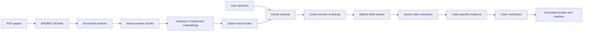

# Research Paper Assistant using RAG

A local, evidence-first question-answering system for scientific papers. The
application parses PDFs with GROBID, preserves document structure, indexes
section-aware chunks in Qdrant, reranks retrieved passages, and uses an Ollama
language model to generate answers. A claim-level verification stage removes
unsupported statements before the final answer is shown.

The Streamlit interface supports focused questions about one paper and
comparisons across several papers. Answers include expandable source passages
and optional verification details.

## Features

- Upload and process multiple scientific PDFs.
- Preserve titles, authors, abstracts, sections, and paragraph provenance.
- Generate semantic embeddings with `all-MiniLM-L6-v2`.
- Store and search vectors using Qdrant and cosine similarity.
- Rerank passages with `ms-marco-MiniLM-L-6-v2`.
- Restrict retrieval to one or several selected papers.
- Generate answers locally with Ollama and `llama3.2:3b`.
- Extract and verify atomic claims against claim-specific evidence.
- Display citations, source excerpts, and verification verdicts.
- Evaluate retrieval, grounding, citation validity, and abstention.

## Architecture



## Requirements

- Python 3.11 or later
- Docker Desktop
- Ollama
- Approximately 4 GB of free disk space

| Service | Address | Purpose |
|---|---|---|
| Streamlit | `http://localhost:8501` | Web interface |
| Qdrant | `http://localhost:6333` | Vector database |
| GROBID | `http://localhost:8070` | Scientific PDF parsing |
| Ollama | `http://localhost:11434` | Local generation and verification |

## Installation

Open PowerShell in the project directory:

```powershell
cd C:\Users\SWS\Desktop\projects\stage\research-paper-assistant
```

Create and activate a virtual environment if one does not already exist:

```powershell
python -m venv venv
.\venv\Scripts\Activate.ps1
python -m pip install --upgrade pip
python -m pip install -r requirements.txt
```

If PowerShell prevents script activation, use the environment executable
directly:

```powershell
.\venv\Scripts\python.exe -m pip install -r requirements.txt
```

## Start the required services

Run each service in a separate PowerShell terminal and leave it running.

### 1. Qdrant

The named volume preserves the vector index when the container stops:

```powershell
docker run --rm --name research-qdrant `
  -p 6333:6333 -p 6334:6334 `
  -v research-qdrant-data:/qdrant/storage `
  qdrant/qdrant
```

Check Qdrant at `http://localhost:6333/healthz`.

### 2. GROBID

```powershell
docker run --rm --name research-grobid `
  -p 8070:8070 `
  lfoppiano/grobid:0.8.2
```

GROBID can take a minute to initialize. Its health endpoint is
`http://localhost:8070/api/isalive`. It is required when processing a new PDF.

### 3. Ollama

Download the configured model once, then start Ollama if necessary:

```powershell
ollama pull llama3.2:3b
ollama serve
```

If port `11434` is already in use, Ollama is normally already running.

## Run the application

From the repository root:

```powershell
.\venv\Scripts\streamlit.exe run app.py
```

Open `http://localhost:8501` if the browser does not open automatically.

## Using the interface

1. Upload one or more PDFs from the sidebar.
2. Click **Process and index**.
3. Wait for parsing, embedding, and indexing to finish.
4. Select one paper for focused question answering.
5. Select several papers for a grounded comparison.
6. Leave the scope empty to search the complete library.
7. Enter a question in the chat field.
8. Expand **Sources** to inspect the retrieved evidence.
9. Expand **Claim verification** to inspect supported and rejected claims.

Use **Fast** answer mode for normal interactive use. It produces a grounded,
cited answer with one Ollama call. Use **Verified** mode when claim-level
checking is required; on a CPU-only machine it can take several minutes because
it performs additional model calls for extraction and verification.

The first indexing or query can be slower because the embedding and reranking
models are loaded into memory on demand.

## Example questions

- What are the main contributions of this paper?
- Which datasets and evaluation metrics were used?
- What limitations do the authors identify?
- Compare BERT with the original Transformer architecture.
- How do the selected papers differ in their training objectives?

## Tests

The unit tests do not require Qdrant, GROBID, or Ollama:

```powershell
.\venv\Scripts\python.exe -m unittest discover -s tests -v
```

## Evaluation

Qdrant, Ollama, and the indexed `research_papers_multi` collection must be
available before running the complete evaluation:

```powershell
.\venv\Scripts\python.exe -m evaluation.run_evaluation
```

Results are written to `evaluation/results/`. See
[`evaluation/README.md`](evaluation/README.md) for configuration and metric
details.

## Project structure

```text
research-paper-assistant/
├── app.py                         # Streamlit interface
├── requirements.txt               # Python dependencies
├── data/
│   ├── raw/                       # Uploaded PDFs
│   └── parsed/                    # GROBID TEI/XML output
├── src/
│   ├── ingestion/                 # Parsing, cleaning, and chunking
│   ├── embeddings/                # Sentence Transformer embeddings
│   ├── retrieval/                 # Search, reranking, evidence routing
│   └── generation/                # Generation and claim verification
├── evaluation/                    # Evaluation data and runners
├── tests/                         # Unit tests
├── notebooks/                     # Development notebook
└── poster/                        # Poster sources and generated PDFs
```

## Troubleshooting

### The interface does not open

Check the terminal for the URL printed by Streamlit. Open
`http://localhost:8501` manually. Streamlit selects another port if 8501 is
already occupied.

### Qdrant is unavailable

```powershell
docker ps
Invoke-WebRequest http://localhost:6333/healthz
```

If the container name is already in use, start the existing container or remove
the stopped container before creating another one.

### PDF indexing fails

Wait for GROBID to finish initializing, then check it:

```powershell
Invoke-WebRequest http://localhost:8070/api/isalive
```

The response should contain `true`. Also confirm that the uploaded file is a
readable PDF.

### Ollama generation fails

```powershell
ollama list
Invoke-WebRequest http://localhost:11434/api/tags
```

The model list must contain `llama3.2:3b`.

### No papers appear in the search scope

Uploading alone is not enough. Click **Process and index** and wait for the
success message. Use the named Qdrant volume shown above so the index persists
when its container is replaced.

### The first request is slow

This is expected while Sentence Transformer models load and Ollama performs the
draft, extraction, and verification passes.

## Current limitations

- Dense retrieval can miss highly specific terminology.
- Small local language models can make semantic verification errors.
- Claim-level verification requires several model calls and increases latency.
- Re-indexing a paper does not automatically remove its older vectors.
- Evaluation quality depends on `evaluation/questions.json` coverage.

## Technology stack

- Python and Streamlit
- GROBID and TEI/XML
- Sentence Transformers
- Qdrant
- Ollama and Llama 3.2 3B
- Docker
